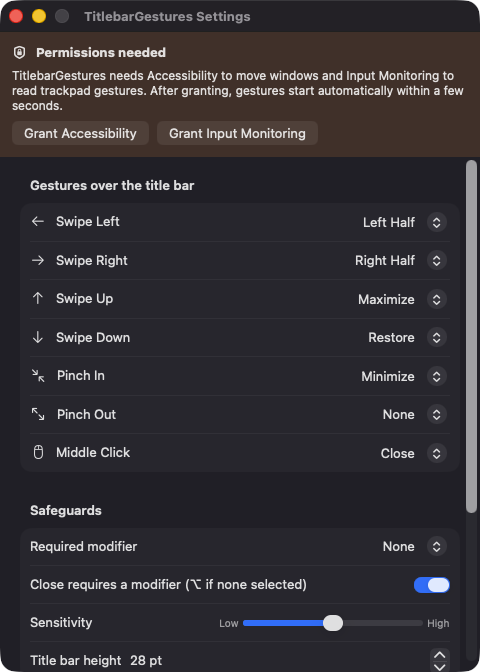
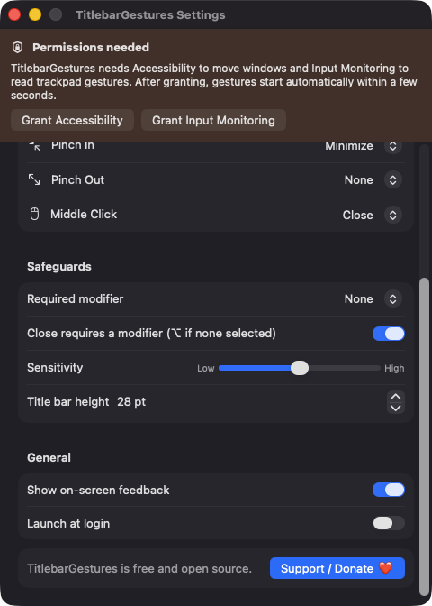
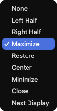
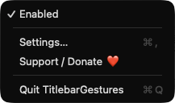

# TitlebarGestures

**🌐 Website:** [turhe123.github.io/titlebar-gestures](https://turhe123.github.io/titlebar-gestures/)

**Resize, close, and snap windows with scroll and pinch gestures over the title bar.**

> 🆓 A free, open-source **Swish alternative** for macOS 14+. Native Swift, no accounts, no subscriptions, MIT licensed.


## Why

TitlebarGestures is a free, open-source, 100% native, backend-free alternative to paid utilities in the *Window Management* category. It was inspired by Swish ($15.99 one-time), which showed how pleasant it is to control windows with trackpad gestures instead of reaching for keyboard shortcuts. This is a clean-room take built only on public macOS APIs. There is no server, no account, no analytics, and no network access.

## Features

- **Title-bar gestures.** When the pointer is over the top band of a window (28 pt by default, adjustable from 16 to 64 pt), two-finger scrolls, pinches and middle-clicks are interpreted as window actions instead of being passed to the app.
- **Seven configurable gestures:** swipe left, swipe right, swipe up, swipe down, pinch in, pinch out and middle click.
- **Nine actions:** None, Left Half, Right Half, Maximize, Restore, Center, Minimize, Close and Next Display.
- **Defaults:** swipe left → Left Half, swipe right → Right Half, swipe up → Maximize, swipe down → Restore, pinch in → Minimize, middle click → Close, pinch out → None.
- **Restore remembers your window.** The previous frame is stored per window before it is moved, so Restore returns it to where it was.
- **Safeguards:**
  - Optional required modifier (⌥, ⌘, ⌃ or ⇧) before any gesture is intercepted.
  - Closing requires a modifier by default (⌥ if none is selected), with a short confirmation tick before the window closes.
  - Sensitivity slider that scales the swipe and pinch thresholds.
  - One action per gesture (debounced), and momentum-phase scroll events are ignored.
  - Natural-scrolling direction is respected.
  - Full-screen windows and the app's own windows are skipped.
  - Buttons, text and search fields, tabs, segmented controls and other controls in the title bar area keep their normal behavior.
- **On-screen feedback** label confirming each action (can be turned off).
- **Menu-bar app** with a hand icon: Enabled toggle, Settings, Support and Quit. It has no Dock icon.
- **Launch at login** via `SMAppService`.
- **Multi-display aware:** snapping uses the visible area of the screen the window is on, and Next Display moves it to the next screen.
- Settings are stored in `UserDefaults` on your Mac.

## Screenshots

<p align="center"></p>

<p align="center"><em>The Settings window maps each title-bar gesture (swipes, pinches and middle click) to a window action like Left Half, Maximize or Close.</em></p>

<p align="center"></p>

<p align="center"><em>Safeguards let you require a modifier key, tune sensitivity and the title-bar height, and toggle on-screen feedback and launch at login.</em></p>

<p align="center"></p>

<p align="center"><em>Each gesture can trigger one of nine actions, from snapping to a half of the screen to moving the window to the next display.</em></p>

<p align="center"></p>

<p align="center"><em>The menu-bar menu lets you turn gestures on or off, open Settings, or quit.</em></p>

## Install

1. Download `TitlebarGestures-macOS.zip` from the [latest release](https://github.com/turhe123/titlebar-gestures/releases/latest).
2. Unzip it and move `TitlebarGestures.app` to `/Applications`.
3. Because the app is open source and not notarized, clear the quarantine flag:

   ```bash
   xattr -cr /Applications/TitlebarGestures.app
   ```

4. Right-click the app and choose **Open** the first time you launch it.

Requires macOS 14.0 or later.

## Build from source

You need Xcode with the macOS 14 SDK and [XcodeGen](https://github.com/yonaskolb/XcodeGen).

```bash
brew install xcodegen
xcodegen generate
xcodebuild -project TitlebarGestures.xcodeproj -scheme TitlebarGestures -configuration Release -derivedDataPath ./build build
```

The app is produced at `build/Build/Products/Release/TitlebarGestures.app`.

## Permissions

TitlebarGestures asks for two privacy permissions. Both can be granted from the banner at the top of the Settings window, which disappears once they are granted.

| Permission | Why |
| --- | --- |
| **Accessibility** | Find the window under the pointer, check that the pointer is in the title bar, and move, resize, minimize or close it through the Accessibility API. Also needed to create the event tap. |
| **Input Monitoring** | Read scroll, middle-click and pinch events so gestures can be recognized. |

The app does **not** request Screen Recording or Microphone access (or Camera, Contacts, Location, etc.), and it does not read window contents. Once permissions are granted, gestures start working automatically within a few seconds.

## Support ❤️

TitlebarGestures is free and always will be. If it saves you some clicks, you can help keep these projects going:

[Support Or (Leo) Davidai ❤️](https://ko-fi.com/leodavidai)

The same link is available from the app's menu and Settings window ("Support / Donate ❤️").

## More free Mac apps

TitlebarGestures is one of [60 free, open-source Mac utilities](https://github.com/turhe123/mac-apps) built the same way: native Swift, no accounts, no telemetry. Browse the full gallery at [turhe123.github.io/mac-apps](https://turhe123.github.io/mac-apps/).

## License

MIT © Or Davidai Bachar
